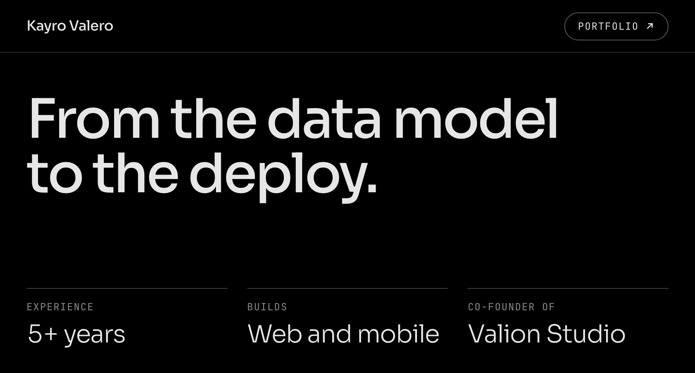
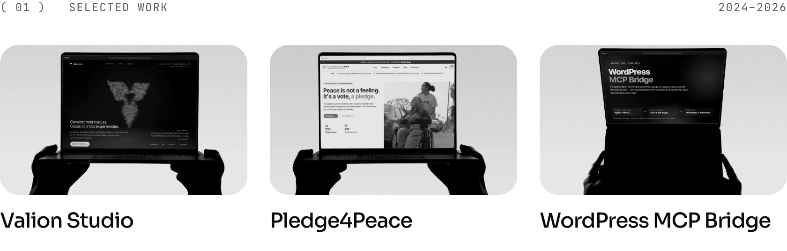
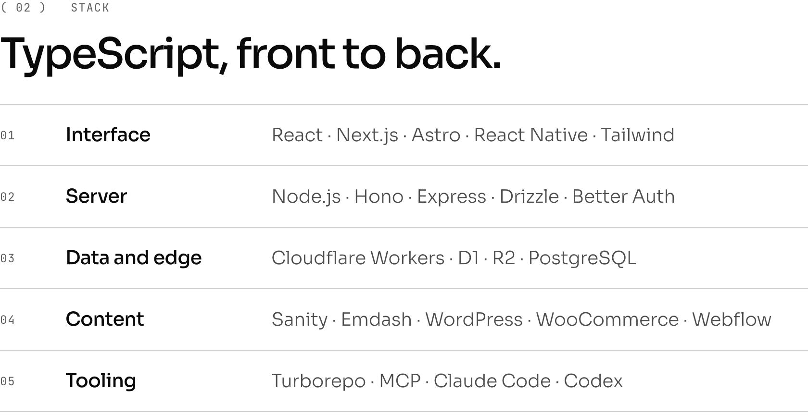
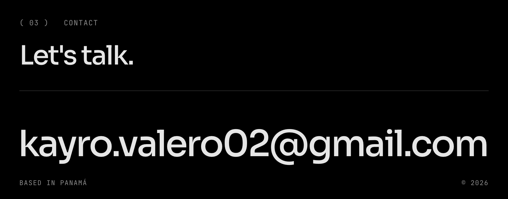

Full-stack developer in Panamá with over five years of experience. I build web and mobile products end to end: data model, API, interface and deploy, mostly in TypeScript on Cloudflare Workers. I co-founded [Valion Studio](https://valionstudio.com), where I handle design and development.

 

<picture>
  <source media="(prefers-color-scheme: dark)" srcset="assets/work-dark.png">
  
</picture>

01&nbsp;&nbsp; **[Valion Studio](https://valionstudio.com)**&nbsp;· Co-founder&nbsp;· 2026–⁠present 
Brand and product studio. I built everything under valionstudio.com: the bilingual site and its core, an API, an internal portal and a CMS on Cloudflare Workers. 
ASTRO · HONO · DRIZZLE · BETTER AUTH · D1 · R2

02&nbsp;&nbsp; **[Pledge4Peace](https://pledge4peace.org)**&nbsp;· Full‑stack developer&nbsp;· 2024–⁠2025 
A platform where citizens vote on solutions and pledge support for peace. Next.js on Workers, a Hono API on D1, and a Sanity Studio with about 19 content types in three languages. 
NEXT.JS · HONO · D1 · SANITY · TURBOREPO

03&nbsp;&nbsp; **WordPress MCP Bridge**&nbsp;· Creator&nbsp;· 2026 
An MCP server and a WordPress plugin in one. Its 29 tools let AI agents build and edit WordPress and Elementor sites through the Abilities API. 
TYPESCRIPT · MCP · PHP · WORDPRESS · ELEMENTOR

04&nbsp;&nbsp; **Logistics operations platform**&nbsp;· Full‑stack developer&nbsp;· 2026–⁠present 
Control center for a logistics company: live fleet tracking over WebSockets and 60+ role-based screens in a Turborepo monorepo, plus the drivers' app in React Native and a client portal. 
REACT · WEBSOCKETS · DRIZZLE · POSTGRESQL · REACT NATIVE

05&nbsp;&nbsp; **[Headless CMS on Cloudflare](https://portfolio-kayro.sannelvalero.workers.dev/)**&nbsp;· Architect and developer&nbsp;· 2026 
The CMS behind my portfolio: Emdash on Workers, with D1 for content and R2 for media. The site stays static and rebuilds itself on every publish. 
ASTRO · EMDASH · D1 · R2 · WORKERS BUILDS

06&nbsp;&nbsp; **[Villa Marena](https://villamarena.com)**&nbsp;· WordPress developer&nbsp;· 2026 
Boutique hotel in Acapulco. Rooms bookable by date with six seasons of rates, Stripe at checkout, and availability synced with Booking.com and Expedia. 
WORDPRESS · ELEMENTOR PRO · MOTOPRESS HOTEL BOOKING · STRIPE

07&nbsp;&nbsp; **[Ojitos Negros](https://modae.shop)**&nbsp;· WooCommerce developer&nbsp;· 2026 
Store for garments embroidered by Otomí artisans. The shop runs on my own engine over the WooCommerce Store API: filters, sorting and paging without reloads. 
WOOCOMMERCE · STORE API · ELEMENTOR PRO

Most of this work lives in private repositories. The case studies, with screens, are on [my portfolio](https://portfolio-kayro.sannelvalero.workers.dev/).

 

<picture>
  <source media="(prefers-color-scheme: dark)" srcset="assets/stack-dark.png">
  
</picture>

 
 

&nbsp;

